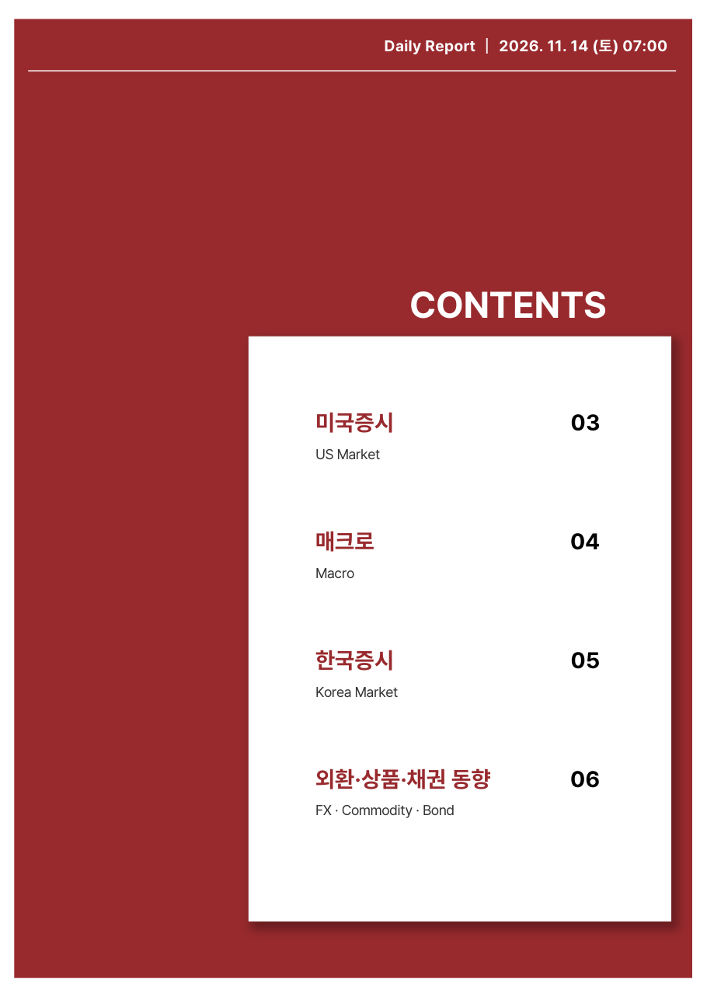
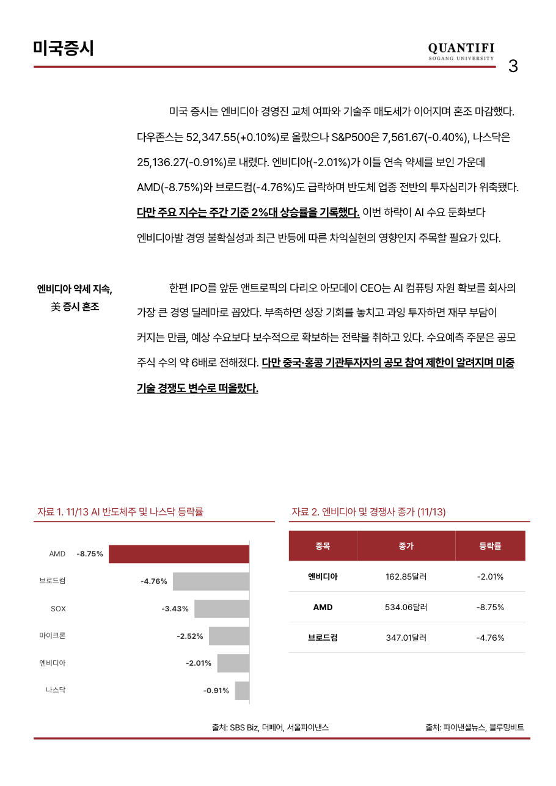
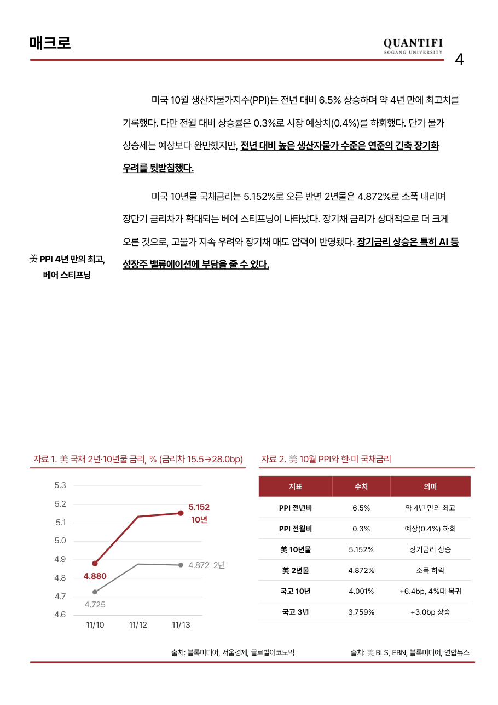
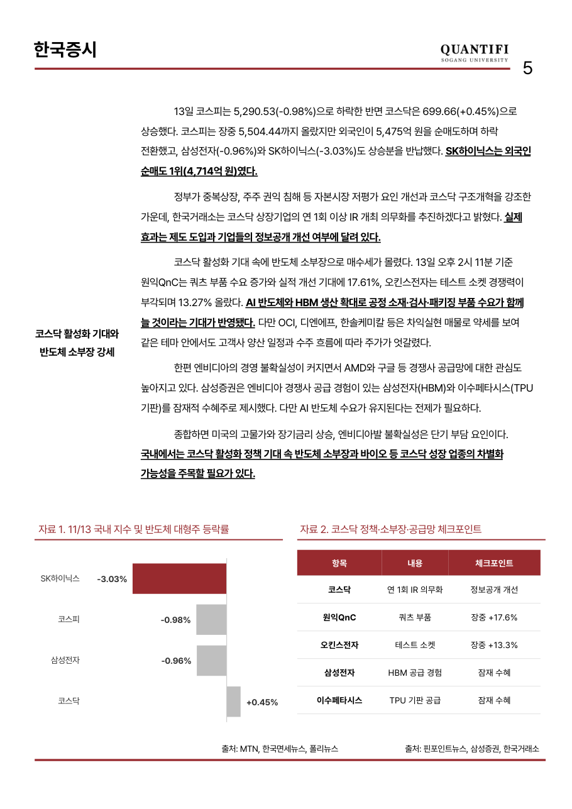
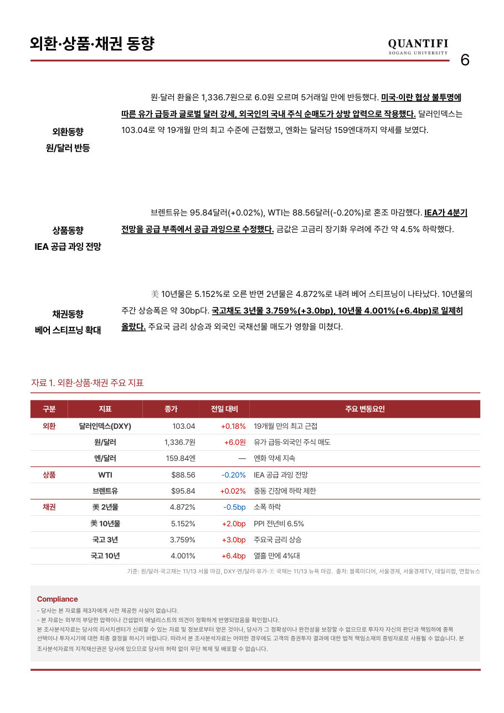

# QUANTIFI 7시 리포트

> 매일 아침 07:00 (일요일 제외) · 06:00 미국장 마감 이후 이슈 반영

**페이지 구성**

| 페이지 | 내용 |
|---|---|
| p.1 | 요약 — 핵심 이슈, 미국·한국 주요 지수, FX·금리·유가, 주요 일정 |
| p.2 | 목차 |
| p.3 | 미국증시 (US Market) |
| p.4 | 매크로 (Macro) |
| p.5 | 한국증시 — 오늘의 전망 및 전일 장 마감 (Korea Market) |
| p.6 | 외환·상품·채권 동향 (FX · Commodity · Bond) |

**+α** : 주요 지표 발표 전날 학회원 토론 기반 지수 예측치 · 퀀트 분석(비정기)

## 🆕 최신 리포트

### [코스닥 다시 부활하나](reports/2026-11-14_daily.pdf)
*엔비디아로 반도체 혼조 속 코스닥의 반도체 소부장 기대*  
2026-11-14 (토) · 📰 Daily

     

## 📚 리포트 목록

| 날짜 | 구분 | 제목 |
|---|---|---|
| 2026-11-14 (토) | 📰 Daily | [코스닥 다시 부활하나](reports/2026-11-14_daily.pdf) |
| 2026-11-13 (금) | 📰 Daily | [젠슨 황 시대 끝났다.](reports/2026-11-13_daily.pdf) |
| 2026-11-12 (목) | 📰 Daily | [AI 투자 심리 개선과 미 증시 상승 마감 – 반도체 반등할까?](reports/2026-11-12_daily.pdf) |
