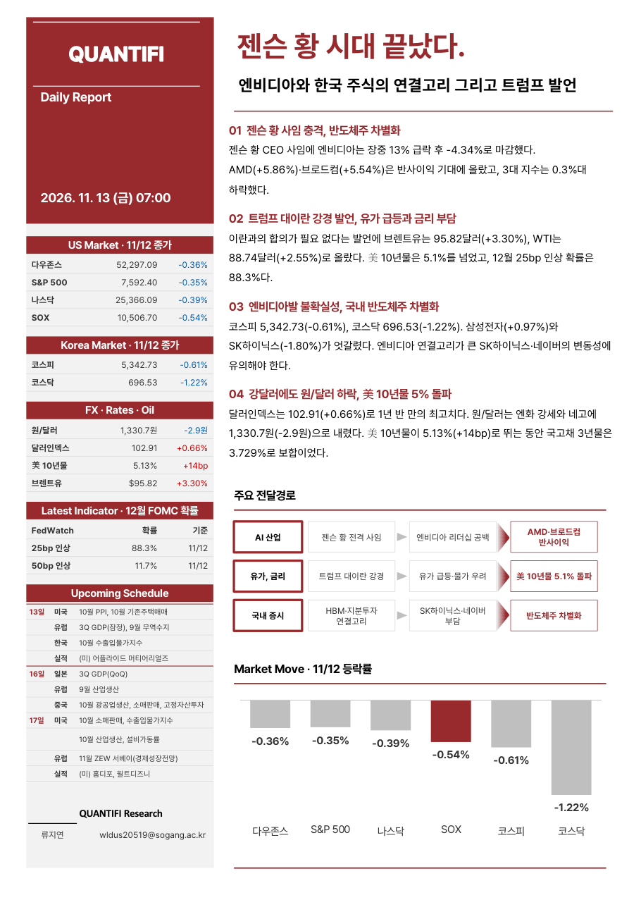

# QUANTIFI 7시 리포트

> 매일 아침 07:00 (일요일 제외) · 06:00 미국장 마감 이후 이슈 반영

**구성** : 미국 증시 → 매크로 → 오늘의 한국 주식 전망 및 전일 장 마감 → FICC 동향  
**+α** : 주요 지표 발표 전날 학회원 토론 기반 지수 예측치 · 퀀트 분석(비정기)

## 🆕 최신 리포트

### [젠슨 황 시대 끝났다.](reports/2026-11-13_daily.pdf)
*엔비디아와 한국 주식의 연결고리 그리고 트럼프 발언*  
2026-11-13 (금) · 📰 Daily

## 📚 리포트 목록

| 날짜 | 구분 | 제목 |
|---|---|---|
| 2026-11-13 (금) | 📰 Daily | [젠슨 황 시대 끝났다.](reports/2026-11-13_daily.pdf) |
| 2026-11-12 (목) | 📰 Daily | [AI 투자 심리 개선과 미 증시 상승 마감 – 반도체 반등할까?](reports/2026-11-12_daily.pdf) |
